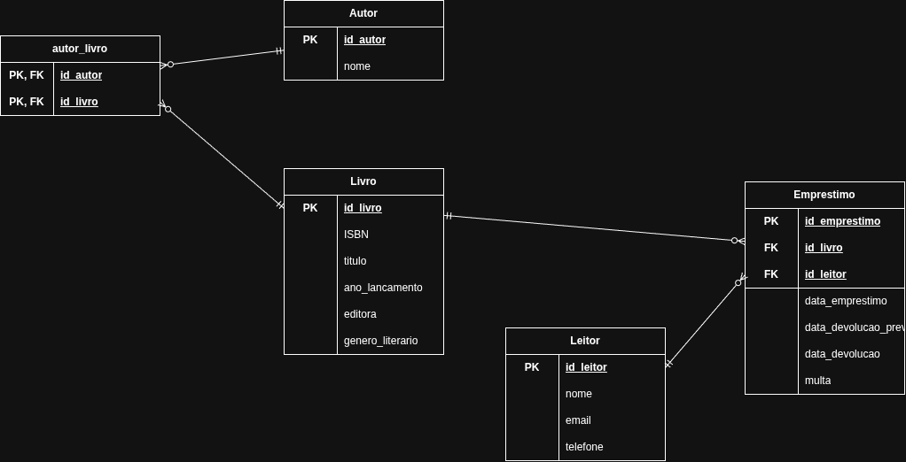

# 📚 Sistema de Biblioteca em SQL

Projeto de banco de dados relacional para o controle de uma biblioteca: cadastro de livros, autores e leitores, registro de empréstimos, cálculo de multas por atraso e análises por meio de consultas SQL, view e índices.

## 🎯 Objetivos

- Modelar um banco de dados relacional com chaves primárias, chaves estrangeiras e relacionamento muitos-para-muitos.
- Popular as tabelas com dados de exemplo.
- Responder perguntas de negócio com consultas SQL (junções, agregações, filtros e subconsultas).
- Calcular multas por atraso.
- Criar uma view para facilitar a consulta de empréstimos em aberto.
- Medir o efeito de um índice no desempenho de uma consulta usando `EXPLAIN`.

## 🗂️ Modelo de dados

O banco é composto por cinco tabelas:

| Tabela        | Descrição                                                              |
|---------------|------------------------------------------------------------------------|
| `autor`       | Autores dos livros.                                                    |
| `livro`       | Livros do acervo da biblioteca.                                        |
| `autor_livro` | Tabela associativa que resolve o relacionamento N:N entre autor e livro. |
| `leitor`      | Pessoas cadastradas que podem pegar livros emprestados.                |
| `emprestimo`  | Registro dos empréstimos feitos pelos leitores.                        |

### Diagrama Entidade-Relacionamento (DER)



## 📁 Estrutura do projeto

```
.
├── src/
│   ├── 01_schema.sql      # Criação das tabelas
│   ├── 02_dados.sql       # Carga de dados de exemplo
│   ├── 03_consultas.sql   # Consultas de análise
│   ├── 04_multas.sql      # Cálculo de multas por atraso
│   ├── 05_view.sql        # View de empréstimos em aberto
│   ├── 06_indice.sql      # Criação de índice
│   └── 07_explain.sql     # Comparação de desempenho com EXPLAIN
├── biblioteca.db          # Banco de dados SQLite
├── diagrama_DER.png       # Diagrama Entidade-Relacionamento
├── LICENSE
├── README.md
└── TODO.md
```

## 🧱 Descrição dos arquivos

### `01_schema.sql`
Cria as tabelas `autor`, `livro`, `autor_livro`, `leitor` e `emprestimo`, com suas chaves e relacionamentos.

### `02_dados.sql`
Insere os dados de exemplo:

- 10 livros
- 8 autores
- 8 leitores
- 20 empréstimos

### `03_consultas.sql`
Reúne as consultas de análise:

1. Listar todos os livros
2. Livros emprestados e nome dos leitores
3. Empréstimos atrasados
4. Os 5 livros mais emprestados
5. Leitores que nunca pegaram um livro
6. Quantidade de livros por gênero literário
7. Média de dias de duração dos empréstimos

### `04_multas.sql`
Calcula a multa por atraso, cobrando **R$ 1,00 por dia** de atraso na devolução.

### `05_view.sql`
Cria e testa uma **view** de empréstimos em aberto, simplificando a consulta dos livros que ainda não foram devolvidos.

### `06_indice.sql` e `07_explain.sql`
Criam um índice e comparam o plano de execução de uma consulta com e sem ele, usando `EXPLAIN`, para mostrar o impacto do índice no desempenho.

## ▶️ Como executar

O projeto usa **SQLite**. Tenha o `sqlite3` instalado (no Ubuntu: `sudo apt install sqlite3`).

1. Clone o repositório e entre na pasta do projeto.
2. Execute os scripts **na ordem numérica**, a partir da raiz:

```bash
sqlite3 biblioteca.db < src/01_schema.sql
sqlite3 biblioteca.db < src/02_dados.sql
sqlite3 biblioteca.db < src/03_consultas.sql
sqlite3 biblioteca.db < src/04_multas.sql
sqlite3 biblioteca.db < src/05_view.sql
sqlite3 biblioteca.db < src/06_indice.sql
sqlite3 biblioteca.db < src/07_explain.sql
```

Para explorar o banco de forma interativa, use `sqlite3 biblioteca.db`.

3. Analise os resultados de cada consulta e compare os planos de execução do `EXPLAIN` antes e depois da criação do índice.

> Se o `biblioteca.db` já tiver as tabelas criadas, apague o arquivo antes de rodar os scripts de novo para evitar erros de tabela duplicada.

> Os scripts `01` e `02` precisam ser executados primeiro, pois os demais dependem das tabelas e dos dados.

## 🧠 Conceitos praticados

- Modelagem relacional e DER
- DDL e DML (`CREATE TABLE`, `INSERT`)
- Relacionamento muitos-para-muitos
- `JOIN`, `GROUP BY`, `ORDER BY`, `LIMIT`
- Funções de agregação (`COUNT`, `AVG`)
- Cálculo com datas
- Subconsultas e `LEFT JOIN` para encontrar registros sem correspondência
- Views
- Índices e análise de desempenho com `EXPLAIN`

## 📄 Licença

Este projeto está sob a licença MIT. Consulte o arquivo [LICENSE](LICENSE) para mais detalhes.

## 👤 Autor

Desenvolvido por **b0t1berto** como projeto de estudo de SQL.